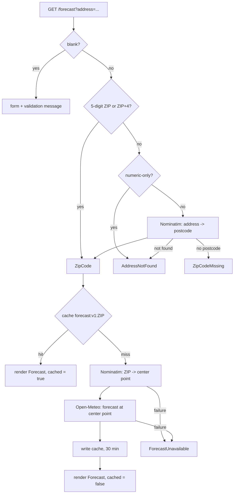

# ZIP Forecast

## Overview

A Ruby on Rails application that looks up the current temperature, today's high/low, and 7-day daily outlook in °F for any US address or ZIP code. Forecasts are cached per 5-digit ZIP code for 30 minutes, and the UI indicates whether each result was fetched live or served from cache.

## Running it

### Native (local Ruby)

- Ruby `4.0.9` (see `.ruby-version`)

```bash
bundle install
bin/rails server
```

Open http://localhost:3000.

### Docker

Requires Docker Compose (no local Ruby needed):

```bash
docker compose up
```

Open http://localhost:3000.

## Running tests

```bash
bin/rails test
bin/rubocop
bin/brakeman --no-pager
```

Tests run offline using Minitest and WebMock (`WebMock.disable_net_connect!`) with JSON fixtures in `test/fixtures/files/`.

## Architecture



### Layer responsibilities

- **`ZipCode` / `Forecast`** (`app/models/`): Immutable `Data` value objects. `ZipCode.parse` normalizes 5-digit and `ZIP+4` strings; `Forecast` serializes to/from plain primitive hashes for caching.
- **`HttpClient`** (`app/clients/http_client.rb`): Shared Faraday builder with JSON parsing, `raise_error`, 3s open timeout, and 5s read timeout.
- **`NominatimClient`** (`app/clients/nominatim_client.rb`): Free-form address-to-ZIP lookup and structured ZIP-to-center-point lookup with an identifying `User-Agent`.
- **`OpenMeteoClient`** (`app/clients/open_meteo_client.rb`): Fetches current temperature and 7-day daily max/min in °F for coordinates.
- **`ForecastLookup`** (`app/services/forecast_lookup.rb`): Orchestrates ZIP resolution, 30-minute `forecast:v1:<zip>` caching, and domain error propagation.
- **`ForecastsController`** (`app/controllers/forecasts_controller.rb`): Thin `show` action mapping `ForecastLookup::Error` subclasses to user-facing messages.

## Decisions & trade-offs

- **Weather provider (Open-Meteo)**: Free, no API key required, supports `temperature_unit=fahrenheit`, `timezone=auto`, and 7-day daily highs/lows in one request.
- **Geocoding provider (Nominatim + usage policy)**: Free OpenStreetMap geocoding without an API key; sends an identifying `User-Agent` and respects its 1 req/s public usage policy.
- **ZIP center point & single forecast cache**: Forecasts are keyed only by 5-digit ZIP (`forecast:v1:<zip>`) and fetched at the ZIP's center point rather than geocoding coordinates per street address.
- **Cache store**: Development uses `:memory_store` (in-memory, zero external setup); tests use `:null_store` by default and swap in `:memory_store` only for caching tests.
- **Plain-hash cache payloads**: `Forecast#to_cache` stores only JSON-safe primitives rather than `Marshal`-ing Ruby objects, avoiding deploy-time deserialization breaks.
- **HTTP client (Faraday)**: Lightweight middleware stack (`:json`, `:raise_error`, 3s/5s timeouts) and easy connection injection for tests.
- **GET form**: `GET /forecast?address=...` keeps lookups bookmarkable/shareable and avoids CSRF/POST-redirect complexity.
- **SQLite kept**: The app has no database tables of its own; SQLite remains configured for Rails 8 defaults (such as Solid Cache).

## Challenges

- **Rate limits and public Nominatim latency**: Nominatim's public endpoint enforces 1 req/s and can occasionally exceed the 5s read timeout, which surfaces cleanly as `ForecastUnavailable`.
- **Ambiguous or non-ZIP inputs**: Partial numeric inputs (like a 4-digit ZIP) are rejected up front instead of being sent to Nominatim's free-form search, where they could match unrelated street/route numbers.
